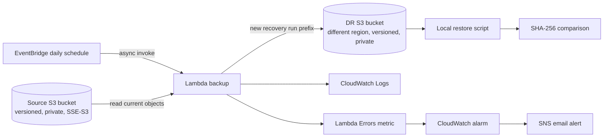

# AWS Cross-Region Disaster Recovery & Backup Automation System

[](https://aws-disaster-recovery-automation.onrender.com/)
[](https://aws.amazon.com/)
[](https://www.terraform.io/)
[](https://python.org/)

> **Live Interactive Cloud Console:** Experience the live system directly in your browser:  
> 🌐 **[https://aws-disaster-recovery-automation.onrender.com/](https://aws-disaster-recovery-automation.onrender.com/)**

An enterprise-grade, auditable Disaster Recovery and Automated Backup architecture designed for production resilience. Combines multi-region Terraform infrastructure, Python/Boto3 serverless orchestration, cryptographic SHA-256 data integrity validation, chaos engineering injection, and an interactive operations console.

## Architecture



### Service roles

- **S3** stores test/source objects and recovery points in two regions. Both buckets have versioning, default SSE-S3 encryption, public access blocks, and a configurable recovery retention lifecycle.
- **Lambda + Boto3** lists source objects with pagination, copies each into a unique timestamp/request-ID prefix, checks copied size, logs a summary, and fails the invocation if any object fails.
- **EventBridge Scheduler rule** invokes the function daily at 02:00 UTC by default.
- **CloudWatch** retains function logs for 14 days and alarms on Lambda errors.
- **SNS** sends alarm notifications to an email address. Confirm the subscription from the email AWS sends after deployment.
- **Terraform** manages resources in both regions through one AWS profile. **Git/GitHub** can track source code; state, plans, generated archives, credentials, and test data stay out of Git.

## Recovery objectives and limits

- **Illustrative RPO:** up to 24 hours for the daily schedule. It is not a guarantee; a failed or delayed run makes the effective recovery point older.
- **Illustrative RTO:** not established until a timed restore drill is completed. It depends on object count, total bytes, network throughput, and local disk speed.
- Each run uses a new prefix. This avoids overwriting earlier recovery points, but increases storage until lifecycle expiry.
- The lab copies current object contents, not every historical S3 version. Source versioning helps protect source history; it is not a version-by-version backup here.
- Object size checking is a transfer sanity check, not cryptographic integrity verification. The recovery drill compares SHA-256 after downloading.
- A single Lambda invocation has a 15-minute maximum. Very large bucket inventories or restore requirements need a different design, such as Step Functions with chunked work, AWS Backup, or S3 replication.
- A CloudWatch `Errors` alarm does not prove a daily run occurred. Production monitoring should also track successful run timestamps/object counts and alarm on a missed backup window.
- SSE-S3 is used to keep this lab simple. Cross-account recovery, customer-managed KMS keys, immutable Object Lock, and regional account separation are production-hardening topics, not implemented controls.

## Prerequisites (Windows PowerShell)

The local workspace check found Git 2.45.1 and Python 3.12.10. Terraform 1.16.5 was installed in the user profile and its executable was verified; open a fresh terminal if `terraform` is not yet on PATH. AWS CLI and AWS identity still need to be configured. The project virtual environment is local and ignored by Git.

From the repository root, create/activate a venv and install the development dependencies:

```powershell
py -m venv .venv
.\.venv\Scripts\Activate.ps1
python -m pip install -r requirements-dev.txt
```

Install AWS CLI v2 from [AWS's official Windows installer](https://aws.amazon.com/cli/). If it requests admin approval, use an approved installer/admin; do not paste credentials into chat. For an organization that uses IAM Identity Center, configure and authenticate a named profile:

```powershell
aws configure sso --profile dr-lab
aws sso login --profile dr-lab
aws sts get-caller-identity --profile dr-lab
```

The identity check should identify the intended lab account before any deployment. An SSO session or assumed role should be used instead of root access keys. The deploying identity needs permissions for the resources in `terraform/` (S3, Lambda, IAM role/policy, EventBridge, CloudWatch, SNS, and reads needed for account identity). Ask an account administrator to grant a bounded lab role if access is unavailable; do not create long-lived access keys for this repository.

## Configure and validate Terraform

Choose two enabled regions appropriate to your account and residency needs. The example pair in the sample variables is only an example. Cross-region transfer and S3 storage are chargeable; select nearby/low-cost regions only after checking the AWS Pricing Calculator and your organization policy. Set a mailbox you can confirm for SNS.

From the repository root:

```powershell
Copy-Item terraform\terraform.tfvars.example terraform\terraform.tfvars
```

Edit `terraform\terraform.tfvars`: set `source_region`, a different `destination_region`, and `alert_email`. Use a unique short lowercase `name_prefix` if the default is already in use. Then:

```powershell
terraform -chdir=terraform fmt -recursive
terraform -chdir=terraform init
terraform -chdir=terraform validate
terraform -chdir=terraform plan -out=lab.tfplan
```

Review the plan and expected charges before applying. `plan` does not provision resources; `apply` does. Applying creates two S3 buckets and configures recurring compute/monitoring/email resources. Costs vary by region, data size, request count, log volume, and run duration. The free tier is not assumed. Never run `apply` until the account, plan, and cost are reviewed.

```powershell
terraform -chdir=terraform apply lab.tfplan
```

Confirm the SNS email subscription, then record outputs (bucket names and function name) without publishing account identifiers if your organization treats them as sensitive:

```powershell
terraform -chdir=terraform output
```

## Local tests

From the repository root:

```powershell
python -m unittest discover -s tests -v
python -m py_compile lambda\backup\app.py scripts\restore_backup.py scripts\verify_restore.py
```

These tests use mocked S3 clients. They do not require AWS credentials and do not prove a deployed backup works.

## Manual backup and recovery drill (requires deployed resources)

Create a small local sample set; never use production data:

```powershell
New-Item -ItemType Directory -Force sample-data\generated | Out-Null
Set-Content sample-data\generated\hello.txt 'DR lab sample'
New-Item -ItemType Directory -Force sample-data\generated\nested | Out-Null
Set-Content sample-data\generated\nested\record.json '{"test":true,"number":1}'
$SourceBucket = terraform -chdir=terraform output -raw source_bucket_name
aws s3 sync sample-data\generated "s3://$SourceBucket/" --profile dr-lab
```

Invoke once manually, then inspect the returned run ID and copy counts:

```powershell
$FunctionName = terraform -chdir=terraform output -raw backup_function_name
aws lambda invoke --function-name $FunctionName --profile dr-lab --cli-binary-format raw-in-base64-out --payload '{}' response.json
Get-Content response.json
```

Take the `run_id` from the response. Use the recovery bucket output and configured destination region:

```powershell
$RecoveryBucket = terraform -chdir=terraform output -raw destination_bucket_name
$RunId = '<run_id from response>'
$RecoveryPrefix = "recovery/$RunId"
python scripts\restore_backup.py --bucket $RecoveryBucket --prefix $RecoveryPrefix --destination restore-output --region <destination-region> --profile dr-lab
python scripts\verify_restore.py --source sample-data\generated --restored restore-output
```

`verify_restore.py` exits non-zero if a file is missing, extra, or has a different SHA-256. Record the backup start/end, invocation result, object counts, restore duration, hashes, and any failures in `docs/drill-results.md`. A successful Lambda invocation alone is not a successful DR drill; restore and data-integrity comparison must pass too.

## Failure investigation

1. Check the CloudWatch alarm state and its 5-minute `AWS/Lambda Errors` metric.
2. Open `/aws/lambda/dr-lab-s3-backup` (or the configured prefix) and find the request ID and `backup_result` JSON summary.
3. For `AccessDenied`, verify the Lambda role's scoped S3 actions, bucket region, and organization SCP/bucket policies. Do not broaden permissions to `s3:*` as a quick fix.
4. For missing recovery objects, inspect the failed object samples and compare `objects_seen` to `objects_copied`; rerun only after diagnosing the cause. Each invocation writes to a new recovery prefix.
5. For a pending alert, confirm the SNS subscription from the email. Check spam/quarantine and the topic subscription status.
6. During a drill, verify the selected run prefix and destination region before downloading. Preserve the original recovery point while investigating.

## Cost and cleanup

Potential charges include source/destination S3 storage and requests, inter-region data transfer, Lambda duration/invocations, CloudWatch logs/metrics/alarms, and SNS notifications. Lifecycle retention is 14 days by default but deletion is asynchronous. Keep sample data small and inspect Billing/Cost Explorer after the lab.

After preserving any desired drill evidence, destroy only this Terraform workspace's resources:

```powershell
terraform -chdir=terraform destroy
```

Review the destroy plan and ensure the source/recovery buckets contain only disposable lab data. Do not delete or edit Terraform state by hand to bypass a failed destroy; investigate first. After successful cleanup, check both regions in the AWS console for remaining resources and review billing.

## Repository layout

```text
lambda/backup/app.py          Scheduled backup handler
terraform/                    Multi-region resources and IAM policy
scripts/restore_backup.py     Recovery point download and timing
scripts/verify_restore.py     SHA-256 restore comparison
tests/                        Offline handler behavior tests
docs/                          Drill evidence and architecture notes
```

## GitHub portfolio

Before publication, verify `terraform.tfvars`, `.tfstate`, `.tfplan`, `.venv`, local sample data, and AWS files are not staged. Review `git status --short` and `git diff --cached` before pushing. Never commit access keys, SSO caches, customer data, Terraform state, or deployment outputs. Add screenshots only after a real deployment, with account IDs, email addresses, ARNs, and sensitive bucket names redacted.

Resume summary (update only after the corresponding work is actually verified):

> Built a Terraform-managed AWS cross-region S3 recovery lab using Python/Boto3, scheduled Lambda backups, least-privilege IAM, CloudWatch alarms, and SNS alerts; validated recovery with local restores and SHA-256 comparisons. *(Add measured recovery time, test size, and deployment evidence after completing the drill.)*

## Interview practice

Use the project to explain the difference between a recovery point and a verified restore, RPO versus RTO, S3 versioning versus a separate-region recovery copy, IAM resource scoping, Lambda timeout/retries, EventBridge delivery, CloudWatch alarms, SNS confirmation, partial failures, retention, state protection, drift, and cost controls. Be explicit that this lab copies current object contents and does not prove account/region-wide failover.